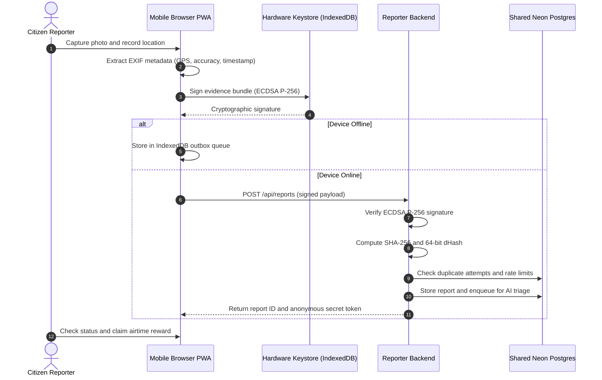

# Kuuma Obutonde: Citizen Environmental Reporter

[](https://github.com/EleanorNabaloga/Wetland-watch/actions/workflows/ci.yml)
[](https://github.com/EleanorNabaloga/Wetland-watch/actions/workflows/merge-guard.yml)
[](https://nodejs.org/)
[](LICENSE)
[](SECURITY.md)

Kuuma Obutonde (Citizen Reporter) is a progressive web application designed for Ugandan citizens to report environmental damage, illegal wetland encroachment, dumping, and industrial pollution. The application empowers whistleblowers through hardware-backed cryptographic evidence signing, anonymous incident tracking, and offline report capture.

The application operates as the public intake component of the Kuuma Obutonde system, sharing an encrypted PostgreSQL database with the staff dashboard:

| Component | Repository | Target Users | Operational Purpose |
| :--- | :--- | :--- | :--- |
| **Citizen Reporter (this repository)** | `Wetland-watch` | General Public | Offline photo capture, hardware evidence signing, duplicate photo rejection, anonymous reward claims. |
| **Staff Dashboard** | [wetland-nema](https://github.com/EleanorNabaloga/wetland-nema) | NEMA Officers | Incident triage with 4-tier AI fallback, statutory SLA tracking, regional hotspot mapping, and audit logging. |

---

## 1. How a Citizen Report Operates



Citizens never create personal login accounts. Each submission generates an unguessable secret token stored in device local storage. The token provides the sole access mechanism to query incident status and redeem verified airtime rewards.

---

## 2. Core Capabilities

### Hardware-Backed Evidence Signing
Every device creates an anonymous ECDSA P-256 cryptographic key pair stored within browser IndexedDB. When an incident is recorded, the device signs a canonical payload containing the photo hash, latitude, longitude, accuracy, and timestamp. The server verifies this signature before accepting the submission, establishing legal integrity for subsequent regulatory inspections.

### Multi-Stage Duplicate Detection
To safeguard staff resources from spam and duplicate submissions, incoming photos undergo two-stage perceptual analysis:
1. **Byte Hash (SHA-256)**: Rejects identical image uploads immediately.
2. **Perceptual Difference Hash (64-bit dHash)**: Computes visual structural difference across image rotations and compression artifacts. If an identical scene is detected within 300 meters inside 48 hours, the submission joins the existing case cluster. If an identical photo is submitted with coordinates far away, the upload is rejected as location fraud.

### Whistleblower Protection and Identity Vault
Whistleblower confidentiality is enforced at the database level:
- Personal telephone numbers for airtime rewards are stored exclusively in the separate `identity_vault` table.
- Numbers are encrypted with AES-256-GCM.
- Staff officers on the review dashboard can only see whether a reward was claimed; they can never view, query, or export citizen phone numbers.

### Offline Progressive Web Application (PWA)
Constructed with service worker caching and IndexedDB queueing. Citizens can record environmental incidents in remote wetland corridors with zero cellular connectivity. The application queues the signed report locally and automatically transmits it once network signal is re-established.

---

## 3. Quickstart Guide

### Prerequisites
- Node.js 20.0.0 or newer
- PostgreSQL database (or Neon PostgreSQL instance)

### Local Development Setup
```bash
# 1. Install dependencies and configure git safeguards
npm ci

# 2. Configure environment file
cp .env.example .env.local

# 3. Start development server
npm run dev

# Access reporter app at: http://localhost:3000
```

### Environment Variables
Configure the following in `.env.local`:

| Variable | Description | Requirement |
| :--- | :--- | :--- |
| `DATABASE_URL` | PostgreSQL connection string with SSL enabled. Must match `wetland-nema`. | Required |
| `PHONE_ENCRYPTION_KEY` | 64-character hexadecimal key used to encrypt reward phone numbers. | Required |

Generate an encryption key:
```bash
node -e "console.log(require('crypto').randomBytes(32).toString('hex'))"
```

---

## 4. Verification and Test Suite

Execute the test suite using the Node.js native test runner:

```bash
# Execute entire test suite (unit, cryptographic, and documentation integrity)
npm test

# Run documentation integrity and link verification specifically
npm run test:docs
```

46 automated tests validate:
- **Documentation Integrity & Synchronization**: Verifies markdown link resolution, environment variable parity against `.env.example`, npm script references, and issue/PR template schemas.
- **Perceptual Hash and Deduplication**: Validates byte-level SHA-256 matching, dHash Hamming distances, cropping tolerance, and geographic clustering.
- **Evidence Verification**: Validates ECDSA P-256 signature generation, payload reconstruction, and rejection of tampered evidence.
- **Reward State Machine**: Verifies that rewards unlock only upon regulatory verification (Emergency, Enforcement, Referral) without false report flags.

---

## 5. Open Source Governance and Fork Policy

### Why We Welcome Forks and Community Cloning
Kuuma Obutonde is licensed under the **GNU Affero General Public License v3 (AGPL-3.0)**. We welcome community forks, security audits, academic research, and international adaptations for conservation monitoring.

To preserve community trust and protect public whistleblowers:
1. **Network Copyleft**: Any public cloud or network service powered by a modified version of this software must release complete source code under the AGPL-3.0.
2. **Trademark Restrictions**: The name Kuuma Obutonde, National Environment Management Authority, and official insignia are protected. Community forks must rebrand and cannot claim official government affiliation.
3. **Data Security**: Cloning the software does not provide access to production database records, encryption keys, or whistleblower vaults.
4. **Merge Protection**: Pull requests from external forks are gated by automated branch protection rules and code owner review (@EleanorNabaloga and @MarkDanielsMCraft).

See [CONTRIBUTING.md](CONTRIBUTING.md) for contribution workflows and [SECURITY.md](SECURITY.md) for vulnerability disclosure procedures.
